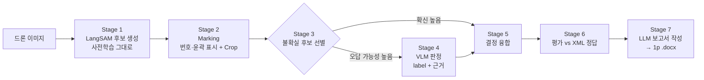

# 전선 검출 파이프라인 프레임워크 설계

> 목적: 드론 영상에서 **전선(power line)** 검출 시, 단순 Object Detection 모델이 틀리는 부분
> (도로 차선, 그림자, 도로 경계, 가드레일, 균열 등 **형태가 비슷한 혼동 객체**)을
> VLM의 **의미적·맥락적 추론**으로 보정할 수 있는지 검증한다.
>
> **모델 학습은 하지 않는다.** 사전학습된 모델(LangSAM, VLM, LLM)을 그대로 조합해서만 사용한다.
> 정답 XML은 평가에만 쓴다.

---

## 1. 전체 구조



| 역할 | 사용 모델 (학습 없음) |
|---|---|
| 후보 생성 (단순 OD 역할) | LangSAM = GroundingDINO(텍스트 → 박스) + SAM(박스 → 마스크) |
| 의미적 재판정 | VLM: Claude API 또는 로컬 Qwen2.5-VL |
| 보고서 문장 작성 | LLM: Claude API 또는 로컬 Qwen2.5-VL |

각 Stage는 **결과 파일 캐시(JSON)** 구조 → LangSAM은 한 번만 돌리고 VLM/프롬프트만 바꿔 반복 실험 가능.

---

## 2. Stage별 설계

### Stage 0. 데이터 로딩 (`data/`)
- 정답 포맷: **CVAT for images 1.1, polyline**. 이미지 200장(3840×2160), 정답 선 4,852개.
- `dataset/` 아래 XML이 있는 폴더를 자동 탐색, 이미지는 그 하위 폴더 어디에 있든 파일명으로 매칭.
- 라벨 `powerline`/`polyline` 둘 다 전선으로 취급 (`data.positive_labels`).
- 학습이 없으므로 split 없이 전체를 평가에 사용 (`--frames`, `--limit`로 일부만 실행 가능).

### Stage 1. 후보 생성 — LangSAM (`detectors/langsam.py`)
- 텍스트 프롬프트: `"power line"`, `"electric wire"`, `"cable"` 앙상블.
- **Recall 우선**: box threshold 0.2 (GroundingDINO 기본 0.3보다 낮게) → 정밀도는 VLM이 담당.
- 4K 이미지에서 전선은 몇 px이므로 **1280px 타일(20% 겹침)로 잘라 추론 후 병합**.
- 후보별 특징 계산: 직선성, 길이, 굵기, 방향, 밝기 대비, 채도, 평행 이웃 수, 지배 방향과의 차이.

### Stage 2. Marking (`marking/`)
- **Set-of-Mark**: 전체 장면에 후보 윤곽 + `#번호` (맥락용) / 후보 확대 crop (디테일용).
- 윤곽은 전선에서 **간격을 두고 바깥에** 그림 → VLM이 표시선이 아닌 전선 자체를 볼 수 있음.

### Stage 3. 불확실 후보 선별 (`fusion/router.py`)
- 점수 애매(0.2~0.45), 차선 의심(밝고 채도 낮고 굵음), 그림자 의심(주변보다 어두움),
  방향 이탈, 짧은 조각 → 하나라도 해당하면 VLM으로. 선별 이유는 프롬프트·보고서에 그대로 사용.
- 주의: 위에서 내려다본 전선도 지면보다 어두운 경우가 많아 그림자 규칙은 진짜 전선도 많이 보냄.

### Stage 4. VLM 판정 (`vlm/`)
- 입력: marking 이미지 2장 + 선별 이유 + 기하 특징 텍스트.
- 출력은 **JSON 스키마로 강제**:
  ```json
  {"cand_id": 3, "is_power_line": false, "confusor_type": "lane_marking",
   "confidence": 0.82, "evidence": ["지면 위 흰색 도색", "도로 방향과 평행"]}
  ```
- 프롬프트의 의미적 판단 기준: 전선은 공중(전주·애자 연결, 평행 다발, 도로 구조와 무관),
  그림자는 지면 위 평행·어긋난 어두운 선, 차선은 노면 도색(흰/노랑, 도로 방향, 경계에서 끊김).
- 백엔드: `claude` (API) / `qwen` (로컬 GPU) / `mock` (흐름 점검용 규칙, 수치 무의미).

### Stage 5. 결정 융합 (`fusion/fuse.py`)
| 상황 | 결과 |
|---|---|
| VLM 안 거침 | 점수 ≥ keep_score(0.3)이면 유지 |
| VLM "전선 아님", 확신도 ≥ 0.6 | 제거 |
| VLM "전선", 확신도 ≥ 0.6 | 유지 (점수가 낮아도) |
| VLM 확신도 낮음 | 점수 기준 |

### Stage 6. 평가 (`eval/`)
- 비교군 (모두 같은 LangSAM 후보에서 계산 → VLM 효과만 분리됨):
  | 구분 | 설명 |
  |---|---|
  | LangSAM 전체 후보 | 낮은 임계값으로 뽑은 후보 전부 (recall 상한 참고) |
  | **LangSAM 단독 (기준)** | 점수 ≥ 0.3인 후보를 전선으로 봄 = 단순 OD의 일반적 사용 |
  | **LangSAM + VLM (제안)** | 최종 판정 |
- 지표: 전선은 몇 px 굵기라 IoU 대신 **선 기반 허용오차(10px)** Precision / Recall / F1.
- 후보 단위 TP/FP → VLM 효과 분류: 오검출 제거 / 전선 회복 / 전선 오제거 / 오검출 추가.
- **혼동 유형별 오검출 제거 수**가 핵심 결과.

### Stage 7. 보고서 생성 (`report/`)
- **역할 분리**: 숫자·서식은 코드가 고정, LLM은 문장만 (글자 수 상한) → 수치 왜곡 방지, 1페이지 보장.
- 구성: 문서정보·결재란 / 1. 개요 / 2. 파이프라인 동작 / 3. 성능 비교 / 4. VLM 판단 사례 / 5. 결론 및 조치.

---

## 3. 디렉토리 구조

```
26-capstone/
├── dataset/                 # 폴더별 드론 이미지 + CVAT XML 정답
├── configs/default.yaml     # 모든 임계값·경로·프롬프트·백엔드 설정
├── src/powerline/
│   ├── data/                # XML 파서, 데이터셋 로딩
│   ├── detectors/           # LangSAM 래퍼, 타일링, 후보 특징
│   ├── marking/             # Set-of-Mark 오버레이, crop
│   ├── fusion/              # 불확실 후보 선별, 결정 융합
│   ├── vlm/                 # 백엔드(claude/qwen/mock), 프롬프트, 출력 스키마
│   ├── eval/                # 선 기반 지표, VLM 효과 분석
│   ├── report/              # 보고서 문장 작성, docx 렌더러
│   ├── pipeline.py          # Stage 1~5 실행·저장
│   └── types.py             # Candidate / Verdict / FinalDecision
├── scripts/
│   ├── inspect_data.py      # 데이터 현황 + 정답 시각화
│   ├── run_pipeline.py      # Stage 1~5
│   ├── evaluate.py          # Stage 6
│   └── make_report.py       # Stage 7
└── outputs/<run>/           # candidates/ decisions/ marked/ metrics.json report.docx (git 제외)
```

## 4. 남은 결정 / 조정 사항
- [x] XML 정답 포맷 → CVAT polyline
- [x] 학습 없음 → 사전학습 모델 조합만
- [ ] 선별 규칙 임계값 (특히 그림자 규칙) — 실데이터 결과 보고 조정
- [ ] VLM 백엔드: Claude API vs 로컬 Qwen 결과 비교
- [ ] 보고서 머리말 항목 (기관 양식 규정이 있으면 반영)
