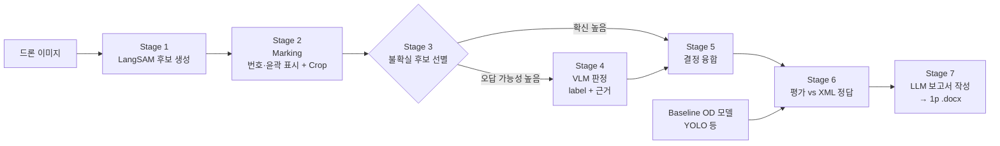

# 전선 검출 파이프라인 프레임워크 설계

> 목적: 드론 영상에서 **전선(power line)** 검출 시, 단순 Object Detection 모델이 틀리는 부분
> (도로 차선, 그림자, 도로 경계, 가드레일, 균열 등 **형태가 비슷한 혼동 객체**)을
> VLM의 **의미적·맥락적 추론**으로 보정할 수 있는지 검증한다.
> 최종 산출물은 검출 결과 + 정답 대비 평가 + **1페이지 공식 Word 보고서**이다.

---

## 1. 전체 구조



각 Stage는 **독립 실행 + 결과 파일 캐시(JSONL)** 구조로 만든다.
→ VLM 프롬프트만 바꿔서 Stage 4부터 재실행하는 식의 실험이 쉬워진다.

---

## 2. Stage별 설계

### Stage 0. 데이터 로딩 (`data/`)
- `dataset/<폴더>/` 의 이미지와 같은 이름의 `.xml` 정답 파일을 매칭.
- XML 파서는 포맷에 맞춰 구현 (Pascal VOC bbox / CVAT polyline·polygon 여부는 데이터 확인 후 확정).
- 전선은 가늘고 길기 때문에 **bbox 정답이라도 내부적으로는 선분/마스크 형태로 변환**해 평가에 쓸 수 있게 한다.
- 촬영 폴더(=비행/장소) 단위로 train/val/test split → 같은 장면이 train/test에 섞이지 않도록.

### Stage 1. 후보 생성 — LangSAM (`detectors/langsam.py`)
- LangSAM = GroundingDINO(텍스트 → box) + SAM(box → mask).
- 텍스트 프롬프트: `"power line"`, `"electric wire"`, `"cable"` 등 앙상블.
- **Recall 우선**: box threshold를 낮게 잡아 전선 후보를 최대한 많이 뽑고, 정밀도는 뒤 단계(VLM)가 담당.
- 고해상도 드론 이미지는 전선이 매우 얇으므로 **타일링(슬라이딩 윈도우) 후 병합** 옵션 제공.
- 각 후보에 기하 특징을 함께 계산: 직선성, 길이, 방향, 이미지 끝까지 이어지는지, 굵기 균일성, 다른 후보와의 평행성.

### Stage 2. Marking (`marking/`)
- **Set-of-Mark 방식**: 원본 위에 후보별 색상 윤곽선 + 번호 태그를 그린 이미지 1장.
- 후보별 **확대 crop (주변 맥락 포함)** 도 함께 생성 → VLM이 "전체 맥락"과 "국소 디테일"을 모두 보게 함.

### Stage 3. 불확실 후보 선별 (`fusion/router.py`)
- 모든 후보를 VLM에 보내지 않고 **오답 가능성이 높은 후보만** 보낸다 (비용·속도).
- 기준 예: 검출 점수 중간 구간, 지면 위 직선(차선 의심), 어두운 선형 영역(그림자 의심), 다른 전선과 방향 불일치 등.
- 이 선별 기준 자체가 보고서의 "판단 대상 선정 근거"가 된다.

### Stage 4. VLM 판정 (`vlm/`)
- 입력: marking 이미지 + 해당 후보 crop + 기하 특징 텍스트.
- 출력은 **JSON 스키마로 강제**:
  ```json
  {
    "cand_id": 3,
    "is_power_line": false,
    "confusor_type": "lane_marking | shadow | road_edge | guardrail | crack | building_edge | branch | other | none",
    "confidence": 0.82,
    "evidence": ["지면 위 흰색 도색", "도로 방향과 평행", "끝점이 도로 경계에서 끊김"]
  }
  ```
- 프롬프트에 의미적 판단 기준을 명시: 전선은 공중에 떠 있어 **그림자와 쌍으로 나타남**, 전주/철탑과 연결, 완만한 처짐(catenary), 도로 구조와 무관한 방향 등.
- 백엔드 교체 가능하도록 인터페이스화: 로컬(Qwen2.5-VL, InternVL 등) / API.

### Stage 5. 결정 융합 (`fusion/`)
- 최종 판정 = f(검출 점수, VLM 판정, VLM confidence). 규칙 기반부터 시작 (예: VLM이 높은 확신으로 부정하면 제거).
- 비교 실험을 위해 융합 전/후 결과를 모두 저장.

### Stage 6. 평가 (`eval/`)
- 비교군:
  | 구분 | 설명 |
  |---|---|
  | B1 | Baseline OD 모델 (예: YOLO, 데이터로 학습) |
  | B2 | LangSAM 단독 (zero-shot) |
  | P1 | LangSAM + VLM (제안 파이프라인) |
  | P2 | Baseline OD + VLM (VLM 효과만 분리 확인용, 선택) |
- 지표: Precision / Recall / F1 (IoU 기준), 전선 특성상 **선 기반 허용오차 매칭(buffer IoU)** 병행.
- **오류 유형 분석**: FP를 혼동 유형(차선/그림자/…)별로 집계 → "VLM이 어떤 유형의 오답을 줄였는가"가 핵심 결과.
- 이미지별로 정답 여부(맞춤/오검출/미검출)를 기록.

### Stage 7. 보고서 생성 (`report/`)
- **역할 분리**: LLM은 *내용(텍스트)* 만 생성, *서식*은 python-docx 템플릿이 고정 → 공식 양식과 1페이지 분량을 코드로 보장.
- LLM 입력: 평가 지표 JSON + 대표 사례(VLM 근거 포함) 몇 건.
- LLM 출력: 필드별 글자 수 제한이 있는 JSON → 템플릿에 채움.
- 1페이지 보고서 양식(안):
  1. 머리말: 문서 제목, 문서번호, 작성일, 작성자/검토자, (결재란)
  2. **개요**: 목적, 대상 데이터 (2~3줄)
  3. **파이프라인 동작 요약**: 단계 흐름 1줄 도식 + 설명
  4. **성능 비교표**: B1 / B2 / P1 의 P·R·F1, 오류 유형별 FP 감소
  5. **VLM 주요 판단 사례**: 썸네일 1~2개 + 판단 근거 (예: "#3은 지면 도색 및 도로와 평행하여 차선으로 판단, 제외")
  6. **결론 및 조치 사항**: 개선 효과, 한계, 담당자 확인 필요 항목

---

## 3. 디렉토리 구조 (예정)

```
26-capstone/
├── dataset/                 # 원본 데이터 (폴더별 드론 이미지 + .xml 정답)
├── configs/
│   └── default.yaml         # 경로, threshold, 프롬프트, VLM 백엔드 등 모든 설정
├── src/powerline/
│   ├── data/                # XML 파서, 데이터셋, split
│   ├── detectors/           # baseline(YOLO), langsam 래퍼
│   ├── marking/             # Set-of-Mark 오버레이, crop
│   ├── vlm/                 # 백엔드 인터페이스, 프롬프트, 출력 스키마
│   ├── fusion/              # 불확실 후보 라우팅, 결정 융합
│   ├── eval/                # 매칭, 지표, 오류 유형 분석
│   ├── report/              # LLM 작성기, docx 렌더러, 템플릿
│   └── types.py             # Candidate / Verdict / Result 데이터 클래스
├── scripts/
│   ├── train_baseline.py
│   ├── run_pipeline.py      # Stage 1~5
│   ├── evaluate.py          # Stage 6
│   └── make_report.py       # Stage 7
├── outputs/                 # 실행 결과 (git 제외)
│   └── <run_id>/{candidates,marked,verdicts,metrics,report}.*
└── docs/ARCHITECTURE.md
```

### 공통 데이터 타입 (`types.py`)
- `Candidate`: image_id, cand_id, source(`yolo`/`langsam`), bbox, mask(RLE), det_score, geom_features
- `Verdict`: cand_id, is_power_line, confusor_type, confidence, evidence
- `FinalDetection`: Candidate + Verdict + final_label + gt_match(TP/FP) 

---

## 4. 구현 순서

1. 데이터 로더 + XML 파서 + 정답 시각화 (데이터 포맷 확정)
2. 평가 모듈 (먼저 만들어 두면 모든 모델을 같은 기준으로 비교 가능)
3. Baseline OD 학습/추론 → **B1 성능 + 오류 사례 수집** (어떤 혼동이 실제로 많은지 확인)
4. LangSAM 후보 생성 + Marking
5. VLM 판정 + 융합 → P1 성능
6. 보고서 생성기

## 5. 결정이 필요한 사항
- [ ] XML 정답 포맷 (bbox / polyline / polygon) — 데이터 확인 후 확정
- [ ] 실행 환경 GPU 사양 (로컬 VLM 사용 가능 여부)
- [ ] VLM 백엔드: 로컬 오픈소스 vs API
- [ ] Baseline OD 모델 종류
- [ ] 보고서 머리말 항목 (기관/양식 규정이 있으면 반영)
